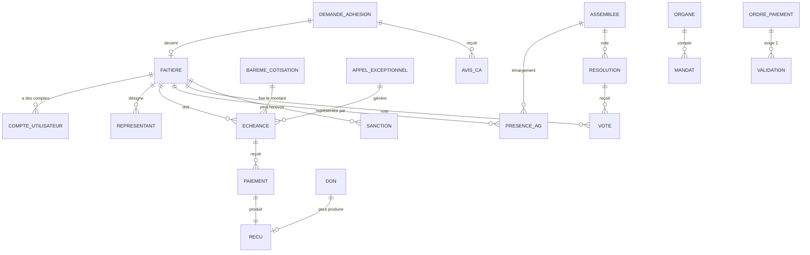

# PSIE — Cahier des charges et architecture (version 2.1 — limité à ce que disent les textes)

> **Statut : cadrage en cours de validation.** Rien n'est encore développé. La version 2.1
> intègre les **Statuts** et le **Règlement Intérieur** de la PSIE (section 9 : ce qu'ils
> imposent à l'outil). **Principe retenu : l'outil applique ce que disent les textes ; tout le
> reste est paramétrable et décidé par les organes dans leur espace.**
>
> PSIE = *Plateforme des Structures Islamiques d'Éducation*, organisation de la société civile
> (Ordonnance n° 2024-368 du 12 juin 2024). Elle regroupe les **faîtières** des structures
> islamiques d'éducation. Les **6 membres fondateurs** sont OEECI, LECIM, IQRA, CHERIFLA,
> AL HIKMA et HINNEH. Les membres cotisent chaque année, et ponctuellement en cas
> d'exception (cotisation exceptionnelle). Siège : mosquée AL FATH, Treichville, Abidjan.

---

## 1. Ce que j'ai compris du modèle LECIM

La LECIM fonctionne sur ce schéma, que la PSIE reproduit **un niveau au-dessus** :

| Niveau | LECIM (existant) | PSIE (à construire) |
|---|---|---|
| Organisation faîtière | LECIM | **PSIE** |
| Membres cotisants | Établissements (écoles, madrassas) | **Faîtières** (dont la LECIM, fondatrice) |
| Cotisation | Annuelle, barème fixe (7 500 / 20 000 FCFA selon statut) + droit d'adhésion unique (12 000 FCFA) | Annuelle (500 000 FCFA) **+ exceptionnelle** + droit d'adhésion |
| Instances | Bureau Exécutif National, délégations régionales, conseil d'administration | Assemblée Générale, Conseil d'Administration (13), Direction Exécutive Nationale (13), Commissariat aux Comptes (2), 2 commissions techniques, 41 délégués régionaux |
| Portails | Admin/BEN, délégation, établissement | Admin/Bureau PSIE, **portail faîtière** |
| Vitrine | Site statique + API publique | Site vitrine PSIE |
| Preuves | Cartes et attestations PDF avec QR code vérifiable | Certificat d'adhésion, attestation de cotisation, reçus |

Ce que la LECIM a déjà et qu'on **réutilise** (code, pas à réinventer) : authentification et
rôles, 2FA par e-mail, journal d'audit, circuit demande d'adhésion → validation → certificat,
gestion des cotisations par année, finances (recettes, dépenses, budget prévisionnel, rapports),
réunions / présences / PV, courrier, newsletter, PWA, sauvegardes chiffrées hors-site,
import Excel, planificateur de relances.

Ce que la LECIM **n'a pas** et qu'il faut **ajouter** pour la PSIE :

1. **Cotisation exceptionnelle** (appel de fonds ponctuel, avec motif, échéance, montant par faîtière).
2. **Paiements multiples par échéance** (la LECIM n'a qu'un `montant_paye` global par année : insuffisant pour des versements échelonnés et des reçus numérotés).
3. **Assemblée Générale** avec convocation, quorum, résolutions et votes.
4. **Catégories de membres** (fondateur / ordinaire / honneur) avec droits associés.
5. **Représentants** : 2 délégués par organisation à l'AG, 2 administrateurs par fondateur au CA.
6. **Double validation des paiements** (DEN + secrétaire aux finances, issus de faîtières différentes) et **accès de contrôle** pour les Commissaires aux comptes.
7. **Régime disciplinaire** (avertissement, blâme, suspension, radiation) et **registre légal des dons** (LBC/FT).

---

## 2. Décision d'architecture n°1 : projet séparé

**Recommandation : créer un dépôt et un déploiement distincts (`projet-psie`), démarrés à partir
du code de la LECIM, et non ajouter la PSIE dans la base LECIM.**

| Option | Avantages | Inconvénients |
|---|---|---|
| A. Même application, multi-tenant | Un seul code | La LECIM est *membre* de la PSIE : mélanger leurs données crée des risques de fuite et un couplage juridique/organisationnel. Un bug LECIM affecterait la PSIE. |
| **B. Projet séparé, code de base copié (recommandé)** | Données et accès totalement isolés ; chaque entité a son rythme, son domaine, ses sauvegardes ; on garde tout ce qui marche | Duplication initiale ; les correctifs de sécurité communs se reportent à la main |
| C. Bibliothèque commune extraite | Zéro duplication | Surdimensionné pour un projet amateur à ce stade |

On part sur **B**, et on pourra extraire un socle commun plus tard si les deux projets durent.
La PSIE aura sa propre base PostgreSQL, son propre `.env`, son domaine, ses sauvegardes.

**✅ Décidé : option B retenue** (projet séparé).

---

## 3. Acteurs et rôles

Les rôles reprennent **les organes réels** de la PSIE (Statuts, art. 10) et non ceux de la LECIM.

| Rôle | Portée | Actions principales |
|---|---|---|
| **Administrateur de la plate-forme** | Technique | Comptes, paramétrage, sauvegardes (jamais d'écriture comptable) |
| **Directeur Exécutif National (DEN)** | Gouvernance et finances | Convoque les AG, décide les appels exceptionnels *(décision de cadrage)*, 1ʳᵉ signature des ordres de paiement |
| **Secrétaire chargé des affaires financières et de la mobilisation des ressources** (et son adjoint) — « trésorier » dans l'outil | Finances | Enregistre les paiements, émet les reçus, 2ᵉ signature des ordres de paiement, rapports financiers (2FA obligatoire) |
| **Autres secrétaires de la DEN** (administration/juridique, formation/pédagogie, examens/concours, information/communication, intégration des écoles/RH) | Leur domaine | Courrier et registres, communication, examens, etc. selon modules cochés |
| **Administrateur du CA** (13, dont le président) | Contrôle | Avis écrits (adhésions, sanctions, ordre du jour AG), validation de la liste de la DEN |
| **Commissaire aux comptes** (2) | Contrôle financier | **Lecture seule sur toute la comptabilité, à toute réquisition**, rapports écrits |
| **Représentant de faîtière** (2 délégués AG par organisation) | Sa faîtière | Situation, échéances, reçus, convocations, émargement |
| **Membre de commission** (CNECI, CNVSP) | Sa commission | Documents et travaux de la commission |
| **Délégué régional** (41 DRENA) | Sa région | Portail délégation (n'est pas membre de l'AG) |
| **Membre d'honneur / personne ressource** | Consultatif | Voix consultative, accès limité |
| **Public** | Vitrine | Actualités, vérification d'un certificat par QR code, demande d'adhésion |

Les rôles s'appuient sur le modèle déjà éprouvé de la LECIM : `access_level` + `allowed_modules`
+ rattachement d'un compte à une faîtière. Un compte peut cumuler une fonction d'organe
(ex. administrateur) et son rattachement à une faîtière.

---

## 4. Modules fonctionnels

### 4.1 Membres et registre des membres
- Fiche : nom, sigle, date de création, statut juridique, siège, contacts, logo, pièces
  (statuts, récépissé, PV de désignation des représentants).
- **Catégories (Statuts art. 8)** : `fondateur` (les 6 listés plus haut) | `ordinaire` |
  `honneur` (personnes physiques ou morales, reconnues par l'AG). Seuls fondateurs et ordinaires
  sont des « membres actifs » qui cotisent et votent.
- Statut : `actif` | `suspendu` | `radié` | `démissionnaire`.
- **Représentants** : 2 délégués AG par organisation ; pour les fondateurs, 2 administrateurs CA.
  Chaque désignation (courrier signé et cacheté en cas de remplacement, art. 22) est conservée.
- Le **registre des membres** exigé par la loi (RI art. 39) est produit automatiquement.
- Faible volume (6 faîtières aujourd'hui) : saisie manuelle, pas d'import de masse.

### 4.2 Adhésion
Circuit conforme aux textes : demande en ligne (code de suivi) → examen par la DEN →
**avis écrit du CA** (art. 18, RI art. 24) → décision de l'AG (l'AGO prononce l'adhésion, l'AGA
en prend connaissance, art. 13) → **certificat d'adhésion PDF à QR code**.
- Conditions vérifiées par l'outil (art. 8.1) : organisation légalement constituée, statuts
  approuvés, **droit d'adhésion acquitté**, engagement de cotiser.
- **Droit d'adhésion** : existe (art. 8.1), **montant non fixé dans les textes**. [À VALIDER]
- Perte de la qualité (art. 9, RI art. 12) : démission écrite, radiation, dissolution.

### 4.3 Cotisations annuelles
- **500 000 FCFA par faîtière et par an**, montant unique ✅. Le taux est fixé par l'**AGO**
  (art. 13.2) : le RI le laisse « à compléter par l'AG ». L'outil le stocke par année avec
  la référence de la résolution d'AG.
- **Année civile** (1ᵉʳ janvier – 31 décembre, art. 36) ✅.
- Échéance générée **automatiquement** chaque année pour chaque membre actif.
- Paiements partiels ou échelonnés, plusieurs versements par échéance.
- Statut calculé : `à jour` | `partiel` | `en retard` | `impayé`.
- **Reçu PDF numéroté** (PSIE-REC-2026-0001) avec QR code ; **attestation de cotisation à jour**.

### 4.4 Cotisations exceptionnelles
Prévues par le RI (art. 14 et 35) « en fonction des besoins du moment », sans autorité de
décision nommée dans les textes.
- **L'autorité de décision n'est pas imposée par l'outil** : les textes n'en nomment aucune. Le
  responsable financier crée l'appel et saisit la **référence de la décision** (PV, résolution)
  et, s'il y en a un, l'avis du CA. L'outil ne bloque rien sur ce point.
- **Montant par faîtière librement saisi** : un montant identique pour toutes (par défaut) ou
  un montant propre à chaque faîtière. Aucune formule ni coefficient imposé.
- Échéances générées automatiquement ; même mécanique de paiement, reçu et relance.
- **Exonération ou report** d'une faîtière, avec motif et trace d'audit.

### 4.5 Relances et notifications (automatisées)
- Rappel e-mail J-30, J-7, J-0, puis relance hebdomadaire après retard.
- Reçu envoyé à chaque paiement ; liste des retards au trésorier chaque lundi.
- Rappels réglementaires : réunion trimestrielle ou quadrimestrielle du CA, **rapport
  semestriel de la DEN au CA** (art. 18), états financiers à disposition **15 jours avant l'AG**
  (art. 36), mandats arrivant à échéance (3 ans), déclaration des changements d'organes à
  l'autorité dans le délai légal (RI art. 39).

### 4.6 Gouvernance : AG, CA, DEN, sanctions
- **Assemblées Générales** : AGA (annuelle), AGO (tous les 3 ans, élections), AGE
  (modification des statuts, dissolution, etc.). **Convocation d'au moins 15 jours**, indiquant
  nature, date, heure, lieu, projet d'ordre du jour ; l'ordre du jour est soumis à l'**avis
  favorable du CA** sauf AGE. L'AGE est convoquée sur demande conjointe de deux organes, ou des
  2/3 des membres, ou par les Commissaires aux comptes si la DEN ne réagit pas (art. 14.2, 29).
- Séance : un président proposé par le DEN et entériné par le CA, **2 assesseurs**.
- **Quorum : 2/3 des membres**. Décisions par consensus, à défaut à la majorité des présents ou
  représentés. **Dissolution : 4/5**. Le calcul du quorum et des votes est automatique.
- **CA** : 13 administrateurs, quorum 2/3, décisions à la majorité des présents, pas de
  procuration (RI art. 23). **Éligibilité d'un administrateur : sa faîtière doit être à jour de
  ses cotisations ordinaires** (art. 20) : l'outil la vérifie.
- **Régime disciplinaire** (RI art. 15) : avertissement → blâme → suspension → radiation.
  Les trois premières sont prononcées par la DEN après avis favorable du CA, notifiées par écrit ;
  l'AGA en est informée. L'outil gère le dossier, les avis et la notification PDF.
- **Impayés** : l'outil **affiche** la situation de cotisation de chaque faîtière (à jour, partiel,
  en retard) à la convocation et à l'émargement, à titre d'information. Il ne bloque ni la
  participation ni le vote : toute mesure relève du régime disciplinaire ci-dessus.
- Visioconférence : le Jitsi de la LECIM peut être réutilisé si besoin.

### 4.7 Finances de la PSIE
- Recettes : cotisations (annuelles, exceptionnelles), droits d'adhésion, dons et legs,
  subventions, autres.
- Dépenses avec justificatifs ; **budget annuel** élaboré par le DEN et validé par l'AGA.
- **Ordre de paiement à double validation** (art. 37-38, RI art. 37) : deux signatures
  électroniques (DEN et secrétaire aux finances ou son adjoint). Règle de l'art. 38 : **le DEN et
  ses trésoriers ne doivent pas être de la même organisation** : l'outil refuse deux
  validateurs issus de la même faîtière.
- **Frais de mission** : remboursement sur ordre de mission et pièces justificatives validés par
  la DEN ; dépense non conforme refusée sauf décision motivée du CA. Fonctions bénévoles.
- **Registre spécial des dons** (art. 39.3, RI art. 40) : identité complète du donateur, date,
  nature, valeur ; **vérification renforcée au-delà du seuil réglementaire** (seuil à confirmer).
- **Déclaration de conflits d'intérêts** par les membres des organes (art. 39.2, RI art. 41).
- **Accès Commissaires aux comptes** : lecture seule de toutes les écritures, pièces et état de
  caisse, rapports écrits adressés à la DEN et au CA.
- **Rapports automatiques** : situation par faîtière, taux de recouvrement, états financiers
  semestriels et annuels (PDF/Excel), à disposition 15 jours avant l'AG.
- Journal d'audit sur toute écriture ; annulation par contre-écriture uniquement.

### 4.8 Documents, registres légaux, courrier, communication
- Bibliothèque : statuts, règlement intérieur, PV, conventions (les conventions signées par le
  DEN nécessitent l'**approbation préalable du CA**, RI art. 28 : circuit d'approbation).
- **Registres légaux** : membres, procès-verbaux AG et CA, comptabilité.
- Courrier arrivée/départ, actualités, galerie, newsletter, vitrine bilingue.

### 4.9 Commissions techniques et représentations régionales *(phase ultérieure)*
- **CNECI** (examens et concours islamiques) : statistiques des examens à grand tirage,
  calendrier, documents consensuels (diplôme, relevés de notes).
- **CNVSP** (validation des manuels et suivi des programmes) : **liste publique des manuels
  homologués**.
- **41 délégations régionales** (DRENA) : tableau de couverture et de répartition entre les
  6 faîtières, validé par le CA ; délégués de circonscription. Réutilise le module délégations
  de la LECIM.

### 4.10 Tableau de bord
- PSIE : membres actifs, taux de recouvrement, dus/encaissés, retards, appels en cours,
  prochaines réunions, mandats arrivant à échéance.
- Faîtière : sa situation financière, ses échéances, ses documents, ses convocations.

### 4.11 Paiement en ligne
Avec 6 faîtières : **enregistrement manuel** (virement, dépôt, espèces) avec justificatif.
Le mobile money est probablement inutile ; à confirmer.

---

## 5. Modèle de données (entités principales)



Points clés :

- **`ECHEANCE`** est la table pivot : une ligne = « telle faîtière doit tel montant, pour tel
  motif (`annuelle` ou `exceptionnelle`), avant telle date ». Cotisations annuelles et appels
  exceptionnels partagent donc **la même mécanique** de paiement, reçu et relance.
- **`PAIEMENT`** : plusieurs par échéance (montant, date, mode, référence, justificatif,
  saisi par). Le solde et le statut de l'échéance sont **calculés** à partir des paiements,
  jamais saisis à la main.
- **`BAREME_COTISATION`** : (année, montant unique) — modifiable sans redéploiement.
- **`MANDAT`** : personne, organe (CA, DEN, CC, commission, délégation), fonction, faîtière
  d'origine, début, fin (3 ans) : alimente les alertes d'échéance.
- **`SANCTION`** : type (avertissement, blâme, suspension, radiation), motif, avis du CA, date de
  notification, information à l'AGA.
- **`ORDRE_PAIEMENT`** + **`VALIDATION`** : deux validations par deux comptes liés à deux
  faîtières différentes ; sans cela l'ordre reste bloqué.
- **`DON`** : registre légal LBC/FT (identité complète du donateur, date, nature, valeur).
- **`APPEL_EXCEPTIONNEL`** : motif, décision d'origine, mode de répartition, date limite, statut.
- Les montants sont stockés en **entiers (FCFA)**, comme dans la LECIM, pas de décimales.
- Aucune suppression physique des écritures financières : annulation par contre-écriture
  (traçabilité).

---

## 6. Architecture technique

```
                 Internet
                    │
        ┌───────────┴────────────┐
        │  Reverse proxy HTTPS    │  (Caddy / Nginx + Let's Encrypt)
        └───────────┬────────────┘
   ┌────────────────┼──────────────────┐
   │                │                  │
 Vitrine         API + Portails      Jitsi (optionnel)
 statique        FastAPI (Python)
 (GitHub Pages)  ├─ /admin      Bureau PSIE / trésorerie
                 ├─ /faitiere   Portail faîtière
                 ├─ /api        Public (vérification QR, adhésion, actus)
                 └─ Scheduler   relances, génération des échéances,
                                sauvegardes, rapports
                    │
              PostgreSQL ──► sauvegarde chiffrée nocturne ──► dépôt privé hors-site
              Fichiers (justificatifs, PDF)
```

| Couche | Choix | Justification |
|---|---|---|
| Backend | **FastAPI + SQLAlchemy 2** | Identique à la LECIM : on réutilise le code et ce que vous connaissez déjà |
| Pages | **Jinja2** rendu serveur | Simple, peu de JavaScript, facile à maintenir seul |
| Base | **PostgreSQL 16** | Fiabilité pour la comptabilité, transactions |
| PDF | **fpdf2** (déjà utilisé) + QR codes | Reçus, certificats, attestations, rapports. **Bilingue FR/AR** : police arabe + mise en forme des lettres liées et sens de lecture droite-gauche à ajouter (point technique à valider par un prototype dès la phase 1) |
| Interface | Jinja2 bilingue FR/AR | Textes traduits, bascule de langue, pages en `dir="rtl"` pour l'arabe |
| Planification | **APScheduler** (déjà utilisé) | Relances, échéances, sauvegardes |
| Vitrine | Site statique | Même approche que la LECIM, coût nul |
| Conteneurs | **Docker Compose** | Démarrage en une commande |
| CI | **GitHub Actions** | Tests et lint automatiques à chaque push |
| Hébergement | VPS Contabo de la LECIM, en pile Docker séparée *(recommandé, voir 6.1)* | Coût nul de plus ; déplaçable ailleurs plus tard grâce à Docker |

### 6.1 Hébergement : Contabo (même VPS que la LECIM) ou Hostinger ?

**Recommandation : démarrer sur le VPS Contabo existant, dans une pile Docker totalement
séparée, à condition de vérifier qu'il reste de la marge.**

| Critère | Même VPS Contabo | Nouveau VPS Hostinger |
|---|---|---|
| Coût | Aucun supplément | Abonnement en plus |
| Charge | Une application légère (6 membres) : négligeable. Mais le VPS porte déjà la LECIM et Jitsi (gourmand) : **à mesurer** | Ressources dédiées |
| Isolation des données | Base, fichiers, `.env`, sauvegardes et domaine **séparés** : sécurité équivalente si bien configuré | Isolation physique totale |
| Panne | Une panne du VPS touche les deux | Indépendance |
| Administration | Une seule machine à surveiller | Deux machines |

Ce choix est **réversible** : tout tourne dans Docker, donc migrer plus tard vers Hostinger
revient à recopier la base et les fichiers. Avant de démarrer, je te donnerai deux commandes à
lancer sur le VPS (mémoire, disque, charge) pour confirmer. Si la marge est faible, on prend le
VPS Hostinger. La PSIE ne déploiera pas son propre Jitsi : la visioconférence réutilise celui de
la LECIM, ou on s'en passe.

**Domaine** : à choisir. Par cohérence avec `lecim-ci.org`, une piste est `psie-ci.org`
(disponibilité à vérifier avant achat).

### Sécurité (héritée de la LECIM et renforcée)
- Mots de passe bcrypt, JWT, **2FA par e-mail obligatoire** pour admin et trésorier.
- Verrouillage après échecs de connexion, limitation de débit, protection CSRF.
- **Cloisonnement strict** : un représentant de faîtière ne voit *jamais* les données d'une autre
  faîtière (filtre systématique par `faitiere_id` côté serveur, avec tests automatisés dédiés).
- Journal d'audit sur toute action sensible (paiement, exonération, changement de barème).
- Sauvegardes nocturnes chiffrées + copie hors-site + **test de restauration** automatisé.

---

## 7. Automatisations prévues

Ce que le système fait seul, sans intervention humaine :

| Automatisation | Déclencheur |
|---|---|
| Création des échéances de cotisation annuelle | Ouverture d'une nouvelle année |
| Création des échéances d'un appel exceptionnel | Validation de l'appel |
| Relances e-mail avant/après échéance | Planificateur quotidien |
| Génération et envoi du reçu PDF | Enregistrement d'un paiement |
| Résumé hebdomadaire des retards au trésorier | Chaque lundi |
| Rapport annuel de recouvrement (PDF + Excel) | Clôture d'année / à la demande |
| Calcul du quorum et du résultat des votes | Clôture d'un scrutin |
| Sauvegarde chiffrée + copie hors-site + test de restauration | Chaque nuit |
| Import en masse des faîtières depuis Excel | Script (modèle du `import_ecoles_excel.py` LECIM) |
| Tests + lint | À chaque push (GitHub Actions) |

---

## 8. Feuille de route par phases

| Phase | Contenu | Livrable utilisable |
|---|---|---|
| **0 — Cadrage** | Valider ce document et lever les écarts entre Statuts et Règlement Intérieur | Cahier des charges v2 |
| **1 — Socle + annuaire** | Nouveau dépôt, auth/rôles/2FA/audit repris, fiches des 6 fondatrices, comptes et mandats des représentants, prototype PDF bilingue FR/AR | Annuaire fonctionnel et sécurisé |
| **2 — Cotisations annuelles** | Barème, échéances auto, paiements, reçus PDF, attestations, relances, tableau de bord trésorier | **Cœur du besoin** : suivi des cotisations |
| **3 — Cotisations exceptionnelles** | Appels de fonds, répartition, exonérations/reports, relances | Gestion des cas d'exception |
| **4 — Adhésion + vitrine** | Demande d'adhésion en ligne, certificat à QR code, site vitrine, actualités | Image publique + nouvelles adhésions |
| **5 — Gouvernance** | Mandats, AG/CA, convocation, quorum, résolutions, votes, sanctions, PV, courrier | Vie statutaire dématérialisée |
| **6 — Finances complètes + rapports** | Recettes/dépenses, double validation des paiements, accès Commissaires aux comptes, registre des dons, frais de mission, états financiers | Redevabilité financière et conformité |
| **7 — Commissions et régions** | CNECI, CNVSP, 41 délégations régionales, liste des manuels homologués | Pilotage pédagogique et territorial |
| **8 — Paiement mobile money** *(option)* | Agrégateur, rapprochement automatique | Probablement abandonnée |

> **Avancement** : phases 1 à 3 réalisées dans [`psie/`](psie/) (annuaire, mandats, cotisations annuelles et exceptionnelles, paiements, reçus et attestations PDF bilingues, relances, double authentification). Détail dans [`psie/README.md`](psie/README.md).

Chaque phase est livrable seule. La **phase 2** est le premier moment où la PSIE tire une vraie
valeur de l'outil.

---

## 9. Ce que disent les Statuts et le Règlement Intérieur

J'ai lu les deux documents en entier. L'outil applique les **Statuts**, qui prévalent sur le RI
(RI art. 2). Voici les points à lever avant de figer le développement.

### 9.1 Écarts entre les textes
Quelques incohérences existent entre les deux documents (dates d'adoption, articles 24 à 27
absents des Statuts, vocabulaire « ordinaires / adhérents », etc.). **Décision : elles n'ont pas
d'impact sur la plateforme et sont ignorées.** En cas de conflit, l'outil suit les Statuts.

### 9.1 bis Points laissés ouverts et paramétrables
| Point | Traitement dans l'outil |
|---|---|
| Montant du droit d'adhésion | Paramètre saisi par le bureau, modifiable |
| Autorité qui décide une cotisation exceptionnelle | Non imposée ; la référence de la décision est saisie |
| Décompte du quorum et mode de vote (délégué ou organisation) | Traité en phase 5 ; paramétrable |
| Seuil légal des dons à vérification renforcée | Paramètre saisi par le responsable financier dans son espace |
| Interdiction de participer à l'AG en cas d'impayé | **Abandonnée** (hors textes) ; information seulement |
| Poids économique, pondération des appels | **Abandonnés** (hors textes) |

### 9.2 Ce que l'outil applique tel quel
Quorum 2/3, dissolution 4/5, convocation à 15 jours, 13 administrateurs (2 par fondateur),
13 membres de la DEN, 2 Commissaires aux comptes, mandats de 3 ans, année civile, double
signature, DEN et trésoriers de faîtières différentes, registre des dons, conflits d'intérêts.

---

## 10. Décisions et points restants

### Décisions prises

| # | Sujet | Décision |
|---|---|---|
| 1 | Architecture | Projet et base séparés, démarrés à partir du code LECIM |
| 2 | Membres | 6 faîtières fondatrices (OEECI, LECIM, IQRA, CHERIFLA, AL HIKMA, HINNEH) ; catégories fondateur / ordinaire / honneur |
| 3 | Cotisation annuelle | **500 000 FCFA** par faîtière et par an, montant unique, année civile ; plus un droit d'adhésion |
| 4 | Cotisation exceptionnelle | Prévue par le Règlement Intérieur ; autorité et montants non imposés par l'outil (décision référencée) |
| 5 | Impayés | Information seulement ; pas de blocage à l'AG |
| 6 | Écarts entre les textes | Ignorés ; en cas de conflit, les Statuts prévalent |
| 7 | Trésorier | Le secrétaire en charge des finances (et son adjoint) |
| 8 | Langues | Français et arabe |
| 9 | Hébergement | VPS Contabo existant, pile séparée (alternative : Hostinger) |
| 10 | Identité visuelle | Le logo de la PSIE existe |
| 11 | Textes | Statuts et Règlement Intérieur reçus et intégrés |
| 12 | Démarrage | Phase 1 lancée ; le logo, les utilisateurs et le domaine viendront plus tard |

### Points laissés pour plus tard
1. Droit d'adhésion, seuil des dons, règles de vote : paramétrables, décidés par les organes.
2. Logo de la PSIE : un logo provisoire (texte) est utilisé en attendant.
3. Noms du DEN, du secrétaire aux finances et de son adjoint : comptes créés à leur arrivée.
4. Nom de domaine et vérification du VPS Contabo : avant la mise en ligne.
5. Validation des traductions arabes : avant la mise en ligne.

> Les montants et règles de la LECIM (7 500 / 20 000 FCFA, 12 000 FCFA, etc.) sont rappelés
> **uniquement comme référence** : rien ne dit qu'ils s'appliquent à la PSIE.
