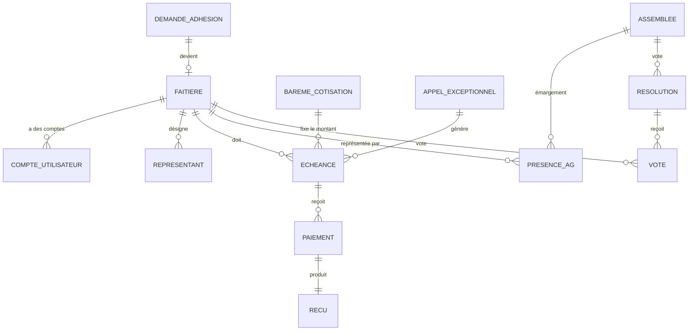

# PSIE — Cahier des charges et architecture (version 1.0 — décisions de cadrage intégrées)

> **Statut : cadrage en cours de validation.** Rien n'est encore développé. La version 1.0
> intègre les premières décisions (section 9). Il reste des points marqués **[À VALIDER]**,
> à trancher notamment avec les statuts de la PSIE (à fournir).
>
> PSIE = *Plate-forme des Structures Islamiques de l'Éducation*. Elle regroupe les **faîtières**
> (fédérations / ligues / associations nationales) des structures islamiques d'éducation. La
> LECIM en est **membre fondateur**. Les faîtières cotisent chaque année, et ponctuellement en
> cas d'exception (appel de fonds exceptionnel).

---

## 1. Ce que j'ai compris du modèle LECIM

La LECIM fonctionne sur ce schéma, que la PSIE reproduit **un niveau au-dessus** :

| Niveau | LECIM (existant) | PSIE (à construire) |
|---|---|---|
| Organisation faîtière | LECIM | **PSIE** |
| Membres cotisants | Établissements (écoles, madrassas) | **Faîtières** (dont la LECIM, fondatrice) |
| Cotisation | Annuelle, barème fixe (7 500 / 20 000 FCFA selon statut) + droit d'adhésion unique (12 000 FCFA) | Annuelle **+ exceptionnelle** (montants à définir) |
| Instances | Bureau Exécutif National, délégations régionales, conseil d'administration | Bureau / secrétariat PSIE, Assemblée Générale, commissions |
| Portails | Admin/BEN, délégation, établissement | Admin/Bureau PSIE, **portail faîtière** |
| Vitrine | Site statique + API publique | Site vitrine PSIE |
| Preuves | Cartes et attestations PDF avec QR code vérifiable | Certificat d'adhésion, attestation de cotisation, reçus |

Ce que la LECIM a déjà et qu'on **réutilise** (code, pas à réinventer) : authentification et
rôles, 2FA par e-mail, journal d'audit, circuit demande d'adhésion → validation → certificat,
gestion des cotisations par année, finances (recettes, dépenses, budget prévisionnel, rapports),
réunions / présences / PV, courrier, newsletter, PWA, sauvegardes chiffrées hors-site,
import Excel, planificateur de relances.

Ce que la LECIM **n'a pas** et qu'il faut **ajouter** pour la PSIE :

1. **Cotisation exceptionnelle** (appel de fonds ponctuel, avec motif, échéance, montant par faîtière).
2. **Paiements multiples par échéance** (la LECIM n'a qu'un `montant_paye` global par année : insuffisant pour des versements échelonnés et des reçus numérotés).
3. **Assemblée Générale** avec convocation, quorum, résolutions et votes.
4. **Catégories de membres** (fondateur / adhérent / observateur) avec droits associés.
5. **Représentants** : chaque faîtière désigne des délégués officiels auprès de la PSIE.

---

## 2. Décision d'architecture n°1 : projet séparé

**Recommandation : créer un dépôt et un déploiement distincts (`projet-psie`), démarrés à partir
du code de la LECIM, et non ajouter la PSIE dans la base LECIM.**

| Option | Avantages | Inconvénients |
|---|---|---|
| A. Même application, multi-tenant | Un seul code | La LECIM est *membre* de la PSIE : mélanger leurs données crée des risques de fuite et un couplage juridique/organisationnel. Un bug LECIM affecterait la PSIE. |
| **B. Projet séparé, code de base copié (recommandé)** | Données et accès totalement isolés ; chaque entité a son rythme, son domaine, ses sauvegardes ; on garde tout ce qui marche | Duplication initiale ; les correctifs de sécurité communs se reportent à la main |
| C. Bibliothèque commune extraite | Zéro duplication | Surdimensionné pour un projet amateur à ce stade |

On part sur **B**, et on pourra extraire un socle commun plus tard si les deux projets durent.
La PSIE aura sa propre base PostgreSQL, son propre `.env`, son domaine, ses sauvegardes.

**✅ Décidé : option B retenue** (projet séparé).

---

## 3. Acteurs et rôles

| Rôle | Portée | Actions principales |
|---|---|---|
| **Super-admin PSIE** | Tout | Paramétrage, comptes, barèmes, audit |
| **Bureau PSIE** (président, SG, …) | Gouvernance | Valider les adhésions, convoquer les AG, suivre les cotisations |
| **Trésorier PSIE** | Finances | Enregistrer les paiements, émettre les reçus, lancer les appels exceptionnels, rapports financiers (2FA obligatoire) |
| **Secrétariat PSIE** | Administratif | Courrier, PV, documents, annuaire des faîtières |
| **Représentant de faîtière** (titulaire) | Sa faîtière | Voir sa situation, ses échéances, ses reçus, ses convocations, voter si l'AG est dématérialisée |
| **Délégué de faîtière** (secondaire) | Rubriques cochées | Accès limité (même logique que « secrétaire d'établissement » dans la LECIM) |
| **Observateur** | Lecture seule | Commissaire aux comptes, audit |
| **Public** | Vitrine | Lire les actualités, vérifier un certificat via QR code, demander l'adhésion |

Les rôles s'appuient sur le modèle déjà éprouvé de la LECIM : `access_level` + `allowed_modules`
(liste de modules cochés par l'admin) + rattachement d'un compte à une faîtière.

---

## 4. Modules fonctionnels

### 4.1 Annuaire des faîtières
- Fiche : nom, sigle, date de création, statut juridique, siège, contacts, logo, représentants légaux.
- **Volume : environ 6 faîtières.** Le volume est petit : on privilégie la simplicité et la
  fiabilité plutôt que la performance ou l'import de masse.
- **Catégorie** : `fondateur` | `adhérent` | `observateur` **[À VALIDER : quelles catégories exactement ?]**.
- **Poids économique** : coefficient propre à chaque faîtière (champ `poids_economique`),
  utilisé pour proposer la répartition des appels exceptionnels (voir 4.4). Défini et modifié
  par le bureau exécutif, avec historique.
- Statut : `active` | `suspendue` | `radiée`.
- Informations de couverture (indicatives) : nombre de structures affiliées, régions, effectifs
  d'élèves — saisis ou mis à jour chaque année par la faîtière elle-même via son portail.
- Pièces : statuts, récépissé, PV de désignation des représentants.

### 4.2 Adhésion
Circuit repris de la LECIM : demande en ligne (code de suivi) → examen par le bureau → validation
→ **certificat d'adhésion PDF avec QR code** vérifiable publiquement.
- **Droit d'adhésion unique** versé à l'entrée : ✅ confirmé. **[À VALIDER : montant]**.
- Les faîtières fondatrices (dont la LECIM) sont créées directement, marquées `fondateur`.

### 4.3 Cotisations annuelles
- **Montant unique pour toutes les faîtières** : ✅ décidé. **[À VALIDER : montant et période
  (année civile ou scolaire)]**.
- Le montant reste **paramétrable par année** (table `bareme_cotisation`) plutôt que codé en
  dur comme dans la LECIM : modifiable sans toucher au code.
- À chaque ouverture d'année : génération **automatique** d'une échéance par faîtière active.
- Paiements partiels et échelonnés, plusieurs versements par échéance.
- Statut calculé : `à jour` | `partiel` | `en retard` | `impayé`.
- **Reçu PDF numéroté** (PSIE-REC-2026-0001) pour chaque versement, avec QR code de vérification.
- **Attestation de cotisation à jour** (utile pour justifier de son statut de membre).

### 4.4 Cotisations exceptionnelles (nouveauté)
Une cotisation exceptionnelle est un **appel de fonds** décidé par une instance (AG ou bureau).
- **Décidée par le bureau exécutif** : ✅ décidé. L'appel enregistre la décision d'origine
  (référence du PV du bureau).
- Création d'un **Appel** : intitulé, motif, décision à l'origine, date limite.
- **Montant différencié selon le poids économique de chaque faîtière** : ✅ décidé. Le
  trésorier saisit une enveloppe globale ; le système **propose** une répartition au prorata
  des coefficients `poids_economique`, que le bureau peut ajuster faîtière par faîtière avant
  validation. Les modes « montant égal pour toutes » et « montant libre » restent possibles.
- Génération automatique des échéances pour toutes les faîtières concernées (ou une sélection).
- Même mécanique de paiement / reçu / relance que la cotisation annuelle.
- Possibilité d'**exonérer** ou de **reporter** une faîtière (avec motif et trace d'audit).

### 4.5 Relances et notifications (automatisées)
- Rappel e-mail **J-30, J-7, J-0** avant échéance, puis relance hebdomadaire après retard.
- Notification à la faîtière à chaque paiement enregistré (reçu en pièce jointe).
- Alerte au trésorier : liste des retards chaque lundi.
- Notification push / PWA optionnelle (déjà présente dans la LECIM).

### 4.6 Gouvernance : Assemblées et réunions
- Réunions du bureau, commissions : convocation, présence, PV (repris de la LECIM).
- **Assemblée Générale** : convocation envoyée aux représentants, émargement (présentiel ou
  en ligne), **calcul du quorum**, résolutions, votes enregistrés.
- **Sanction en cas d'impayé : interdiction de participer à l'Assemblée** : ✅ décidé.
  Le système bloque automatiquement l'émargement et l'accès au scrutin d'une faîtière en
  situation d'impayé, et l'indique sur la convocation. **[À VALIDER : la sanction vaut-elle
  pour la cotisation annuelle seule ou aussi pour les appels exceptionnels ? Après quel délai
  de retard ? Y a-t-il une procédure de régularisation sur place ?]**
- Règle de vote : 1 faîtière = 1 voix **[À VALIDER]**.
- Visioconférence : le Jitsi auto-hébergé de la LECIM peut être réutilisé.

### 4.7 Finances de la PSIE
- Recettes : cotisations annuelles, exceptionnelles, droits d'adhésion, subventions, dons.
- Dépenses avec justificatifs, budget prévisionnel vs réalisé.
- **Rapports automatiques** : situation par faîtière, taux de recouvrement, bilan annuel (PDF/Excel).
- Journal d'audit sur toute écriture financière.

### 4.8 Documents, courrier, communication
- Bibliothèque de documents (statuts, règlement intérieur, PV, conventions), accès par rôle.
- Registre du courrier arrivée/départ.
- Actualités, galerie, newsletter, vitrine publique.

### 4.9 Tableau de bord
- Pour la PSIE : nombre de faîtières, taux de recouvrement de l'année, montants dus/encaissés,
  retards, appels exceptionnels en cours, prochaines réunions.
- Pour une faîtière : sa situation financière, ses prochaines échéances, ses documents.

### 4.10 Paiement en ligne (phase ultérieure)
Mobile money (Orange Money, MTN MoMo, Wave) via un agrégateur, avec rapprochement automatique.
Au départ : **enregistrement manuel** par le trésorier (virement, dépôt, espèces) avec
justificatif. **[À VALIDER : paiement en ligne souhaité à terme ?]**

---

## 5. Modèle de données (entités principales)



Points clés :

- **`ECHEANCE`** est la table pivot : une ligne = « telle faîtière doit tel montant, pour tel
  motif (`annuelle` ou `exceptionnelle`), avant telle date ». Cotisations annuelles et appels
  exceptionnels partagent donc **la même mécanique** de paiement, reçu et relance.
- **`PAIEMENT`** : plusieurs par échéance (montant, date, mode, référence, justificatif,
  saisi par). Le solde et le statut de l'échéance sont **calculés** à partir des paiements,
  jamais saisis à la main.
- **`BAREME_COTISATION`** : (année, montant unique) — modifiable sans redéploiement.
- **`FAITIERE.poids_economique`** : coefficient servant à proposer la répartition d'un appel
  exceptionnel ; chaque modification est historisée (audit).
- **`PRESENCE_AG`** porte un indicateur `autorisee` calculé : faux si la faîtière a une échéance
  en retard soumise à la sanction.
- **`APPEL_EXCEPTIONNEL`** : motif, décision d'origine, mode de répartition, date limite, statut.
- Les montants sont stockés en **entiers (FCFA)**, comme dans la LECIM, pas de décimales.
- Aucune suppression physique des écritures financières : annulation par contre-écriture
  (traçabilité).

---

## 6. Architecture technique

```
                 Internet
                    │
        ┌───────────┴────────────┐
        │  Reverse proxy HTTPS    │  (Caddy / Nginx + Let's Encrypt)
        └───────────┬────────────┘
   ┌────────────────┼──────────────────┐
   │                │                  │
 Vitrine         API + Portails      Jitsi (optionnel)
 statique        FastAPI (Python)
 (GitHub Pages)  ├─ /admin      Bureau PSIE / trésorerie
                 ├─ /faitiere   Portail faîtière
                 ├─ /api        Public (vérification QR, adhésion, actus)
                 └─ Scheduler   relances, génération des échéances,
                                sauvegardes, rapports
                    │
              PostgreSQL ──► sauvegarde chiffrée nocturne ──► dépôt privé hors-site
              Fichiers (justificatifs, PDF)
```

| Couche | Choix | Justification |
|---|---|---|
| Backend | **FastAPI + SQLAlchemy 2** | Identique à la LECIM : on réutilise le code et ce que vous connaissez déjà |
| Pages | **Jinja2** rendu serveur | Simple, peu de JavaScript, facile à maintenir seul |
| Base | **PostgreSQL 16** | Fiabilité pour la comptabilité, transactions |
| PDF | **fpdf2** (déjà utilisé) + QR codes | Reçus, certificats, attestations, rapports |
| Planification | **APScheduler** (déjà utilisé) | Relances, échéances, sauvegardes |
| Vitrine | Site statique | Même approche que la LECIM, coût nul |
| Conteneurs | **Docker Compose** | Démarrage en une commande |
| CI | **GitHub Actions** | Tests et lint automatiques à chaque push |
| Hébergement | VPS (comme la LECIM) | Un second conteneur suffit **[À VALIDER : même VPS ou autre ?]** |

### Sécurité (héritée de la LECIM et renforcée)
- Mots de passe bcrypt, JWT, **2FA par e-mail obligatoire** pour admin et trésorier.
- Verrouillage après échecs de connexion, limitation de débit, protection CSRF.
- **Cloisonnement strict** : un représentant de faîtière ne voit *jamais* les données d'une autre
  faîtière (filtre systématique par `faitiere_id` côté serveur, avec tests automatisés dédiés).
- Journal d'audit sur toute action sensible (paiement, exonération, changement de barème).
- Sauvegardes nocturnes chiffrées + copie hors-site + **test de restauration** automatisé.

---

## 7. Automatisations prévues

Ce que le système fait seul, sans intervention humaine :

| Automatisation | Déclencheur |
|---|---|
| Création des échéances de cotisation annuelle | Ouverture d'une nouvelle année |
| Création des échéances d'un appel exceptionnel | Validation de l'appel |
| Relances e-mail avant/après échéance | Planificateur quotidien |
| Génération et envoi du reçu PDF | Enregistrement d'un paiement |
| Résumé hebdomadaire des retards au trésorier | Chaque lundi |
| Rapport annuel de recouvrement (PDF + Excel) | Clôture d'année / à la demande |
| Calcul du quorum et du résultat des votes | Clôture d'un scrutin |
| Sauvegarde chiffrée + copie hors-site + test de restauration | Chaque nuit |
| Import en masse des faîtières depuis Excel | Script (modèle du `import_ecoles_excel.py` LECIM) |
| Tests + lint | À chaque push (GitHub Actions) |

---

## 8. Feuille de route par phases

| Phase | Contenu | Livrable utilisable |
|---|---|---|
| **0 — Cadrage** | Valider ce document, trancher les points ouverts, collecter statuts de la PSIE | Cahier des charges v1 |
| **1 — Socle + annuaire** | Nouveau dépôt, auth/rôles/2FA/audit repris, fiches faîtières, comptes représentants, import Excel, import de la LECIM comme fondatrice | Annuaire fonctionnel et sécurisé |
| **2 — Cotisations annuelles** | Barème, échéances auto, paiements, reçus PDF, attestations, relances, tableau de bord trésorier | **Cœur du besoin** : suivi des cotisations |
| **3 — Cotisations exceptionnelles** | Appels de fonds, répartition, exonérations/reports, relances | Gestion des cas d'exception |
| **4 — Adhésion + vitrine** | Demande d'adhésion en ligne, certificat à QR code, site vitrine, actualités | Image publique + nouvelles adhésions |
| **5 — Gouvernance** | Réunions, AG, quorum, résolutions, votes, PV, documents, courrier | Vie statutaire dématérialisée |
| **6 — Finances complètes + rapports** | Recettes/dépenses, budget prévisionnel, rapports automatiques | Redevabilité financière |
| **7 — Paiement mobile money** *(option)* | Agrégateur, rapprochement automatique | Encaissement en ligne |

Chaque phase est livrable seule. La **phase 2** est le premier moment où la PSIE tire une vraie
valeur de l'outil.

---

## 9. Décisions et points restants

### Décisions prises

| # | Sujet | Décision |
|---|---|---|
| 1 | Architecture | Projet et base séparés, démarrés à partir du code LECIM |
| 2 | Volume | Environ 6 faîtières |
| 3 | Cotisation annuelle | Montant unique pour toutes les faîtières, plus un droit d'adhésion |
| 4 | Cotisation exceptionnelle | Décidée par le bureau exécutif ; montant variable selon le poids économique de chaque faîtière |
| 5 | Sanction d'impayé | Interdiction de participer à l'Assemblée |
| 6 | Statuts de la PSIE | À fournir (documents en attente) |

### Points encore ouverts

1. **Montants** : cotisation annuelle, droit d'adhésion. Période : année civile ou scolaire ?
2. **Catégories de faîtières** : fondateur / adhérent / observateur, ou autre ?
3. **Poids économique** : sur quelle base est-il fixé (chiffre d'affaires, nombre d'élèves, nombre de structures, décision du bureau) ? Fixé une fois ou révisé chaque année ?
4. **Sanction** : s'applique-t-elle aux appels exceptionnels aussi ? Après quel délai ? Procédure de régularisation ?
5. **Assemblée Générale** : 1 faîtière = 1 voix ? Combien de représentants par faîtière ? Quorum ?
6. **Utilisateurs PSIE** : qui sera trésorier, secrétariat, administrateur de la plate-forme ?
7. **Paiements** : virement, espèces, mobile money ? Avec 6 faîtières, le paiement en ligne (phase 7) est probablement inutile : on garde l'enregistrement manuel avec justificatif.
8. **Langues** : français seul, ou français + arabe ?
9. **Domaine et hébergement** : un domaine existe-t-il ? Même VPS que la LECIM ?
10. **Identité visuelle** : logo et charte graphique de la PSIE.
11. **Statuts de la PSIE** : à transmettre ; je recalerai alors quorum, vote, sanctions et cotisations sur le texte réel.

### Ajustements de la feuille de route liés au faible volume (6 faîtières)

- Phase 1 : saisie manuelle des faîtières (l'import Excel devient optionnel).
- Phase 7 (paiement mobile money) : probablement abandonnée, à confirmer.
- Priorité maintenue : la phase 2 (cotisations annuelles) puis la phase 3 (appels exceptionnels avec répartition par poids économique), puis la phase 5 pour le blocage automatique à l'Assemblée.

> Les montants et règles de la LECIM (7 500 / 20 000 FCFA, 12 000 FCFA, etc.) sont rappelés
> **uniquement comme référence** : rien ne dit qu'ils s'appliquent à la PSIE.
